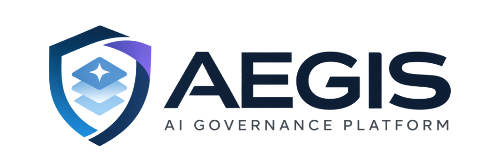

<p align="center">
  
</p>

# Aegis: AI Governance Platform

An evidence-based enterprise AI governance and agent appraisal web application operationalising **FRAME** and **AAEF** (by Ian Loe, Tactics Solutions, licensed under Creative Commons BY-NC 4.0).

- **FRAME** provides the enterprise governance envelope across five dimensions: **Focus**, **Roles**, **Authority**, **Metrics**, and **Evaluation**.
- **AAEF (AI Agent Evaluation Framework)** evaluates AI agents inside that envelope across **Task Competence**, **Judgement Quality**, **Boundary Adherence** (binary), **Collaboration Effectiveness**, and **Improvement Trajectory**, assigning one of four performance profiles: **Operational**, **Developing**, **Restricted**, or **Under Review**.

---

## 1. Quick Start (Single Command with Docker Compose)

No local Node.js or PostgreSQL installation is required.

1. Copy the environment template and set strong secrets:
   ```bash
   cp .env.example .env
   ```
   Edit `.env` and replace all `CHANGE_ME_*` placeholders:
   - `POSTGRES_PASSWORD`: strong database password
   - `DATABASE_URL`: update the password portion to match `POSTGRES_PASSWORD`
   - `SESSION_SECRET`: at least 32 random characters (for example `openssl rand -hex 32`)
   - `INITIAL_ADMIN_EMAIL` and `INITIAL_ADMIN_PASSWORD`: initial administrator credentials
   - `SEED_DEMO_DATA`: defaults to `false` for a clean production start. Set to `true` to load the fictional demo dataset (12 AI assets across 3 business units and 2 countries, 20 risks, 10 incidents, 2 AAEF appraisal cycles, and SGD ROI data).

2. Start the application and PostgreSQL 16 database:
   ```bash
   docker compose up --build -d
   ```

3. Open `http://localhost:3000` and sign in with `INITIAL_ADMIN_EMAIL` and `INITIAL_ADMIN_PASSWORD`.

4. Health check endpoint:
   ```bash
   curl http://localhost:3000/api/health
   ```

---

## 2. Architecture and Packaging

- **Stack**: Next.js (App Router), TypeScript, Tailwind CSS, Recharts, and PostgreSQL 16 via Prisma ORM.
- **Services**:
  - `db`: `postgres:16-alpine` with `pg_isready` health check and named volume `postgres_data`. The PostgreSQL port is not published to the host by default.
  - `app`: Multi-stage Dockerfile running as non-root user `nextjs` (`UID 1001`), waiting for `db` health check, automatically applying Prisma migrations (`prisma migrate deploy`), seeding reference configuration, and mounting named volume `evidence_uploads` at `/app/uploads`.
  - `adminer` (optional): database inspection UI enabled only when requested via `docker compose --profile tools up -d` on port `8080`.
- **Production Secret Guard**: In production mode (`NODE_ENV=production`), `docker-entrypoint.sh` refuses to start if `SESSION_SECRET` or `INITIAL_ADMIN_PASSWORD` are unset or still contain placeholder values.

### Development Mode (Hot Reload)
To run with source bind-mounts and hot reload:
```bash
docker compose -f docker-compose.yml -f docker-compose.dev.yml up --build
```

### Local Host Database Debugging
If you need direct host access to PostgreSQL on `127.0.0.1:5432`, copy the override example:
```bash
cp docker-compose.override.yml.example docker-compose.override.yml
docker compose up -d
```

---

## 3. Backup, Restore, and Machine Migration

### On-Demand Backup
Run the included backup script (uses `pg_dump -Fc` inside the `db` container):
```bash
./scripts/backup.sh
```
This writes a compressed custom-format dump to `./backups/aegisx_YYYYMMDD_HHMMSS.dump`.

### Restore from Backup
```bash
./scripts/restore.sh ./backups/aegisx_YYYYMMDD_HHMMSS.dump
```

### Scheduled Backups (Cron)
To run daily automated backups at 02:00 and retain 30 days of dumps, add a cron entry on the host:
```cron
0 2 * * * cd /path/to/aegisx && ./scripts/backup.sh && find ./backups -name "aegisx_*.dump" -mtime +30 -delete
```

### Moving Data to Another Machine
1. On the source machine, run `./scripts/backup.sh` and archive the uploaded evidence volume:
   ```bash
   ./scripts/backup.sh
   docker compose cp app:/app/uploads ./backups/uploads_backup
   ```
2. Copy the `.dump` file, `./backups/uploads_backup`, and `.env` to the target machine.
3. On the target machine, start the stack (`docker compose up -d`), restore the database, and copy the uploaded files:
   ```bash
   ./scripts/restore.sh ./backups/aegisx_YYYYMMDD_HHMMSS.dump
   docker compose cp ./backups/uploads_backup/. app:/app/uploads
   ```

---

## 4. Recommended Resource Limits

For production deployments, apply container resource limits in `docker-compose.override.yml` or your orchestrator:
- `app`: `1.0` CPU, `512M` to `1G` RAM.
- `db`: `1.0` to `2.0` CPU, `1G` to `2G` RAM, SSD-backed storage for `/var/lib/postgresql/data`.

---

## 5. Replacing Placeholder Framework Content

Where official wording from `github.com/ianloe/FRAME` and `github.com/ianloe/AAEF` was not supplied in the specification, configuration records are labelled `[PLACEHOLDER]`:
- `prisma/seed-data/frame-criteria.json`: 15 criteria and 0 to 4 maturity rubrics.
- `prisma/seed-data/aaef-profiles.json`: 4 AAEF performance profiles and rule thresholds.
- `src/lib/governance/roi-engine.ts`: extension stubs (`TODO`) for the **Agentic P&L Framework** and **Capability Capitalisation Model**.

All scoring rubrics, profile rules, risk appetite thresholds, and framework crosswalks are editable live in the **Admin Config** screen (`/admin`) without code changes.

---

## 6. Testing

Run the unit test suite (Vitest) covering FRAME scoring, AAEF trajectory and profile assignment, risk appetite evaluation, ROI/NPV/Value-at-Risk calculations, CSV round-tripping, and A4 PDF Board Pack generation:
```bash
npm test
```

---

## Attribution

**FRAME and AAEF by Ian Loe, Tactics Solutions, licensed CC BY-NC 4.0.**
